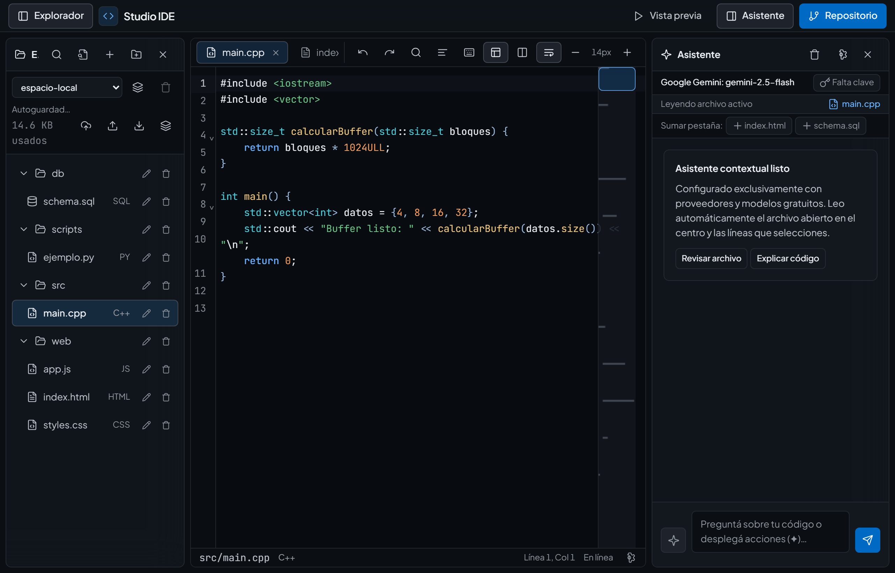
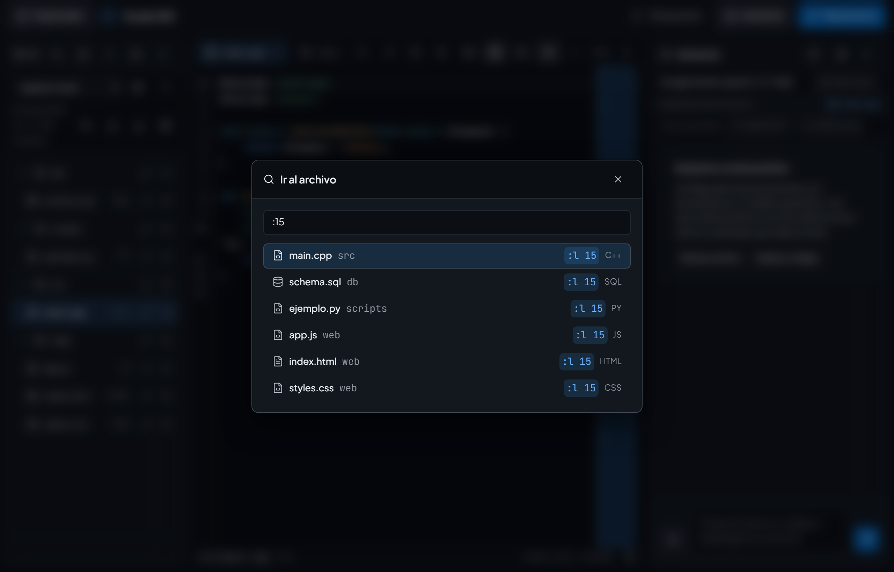
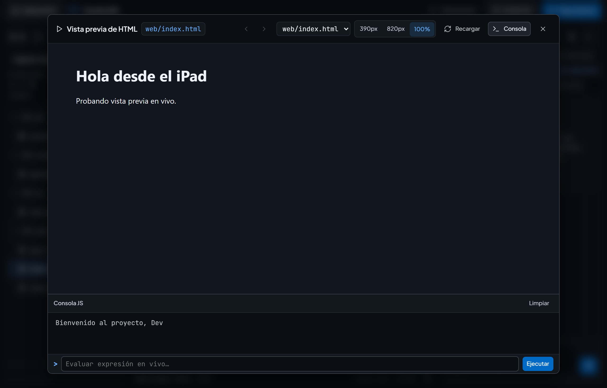
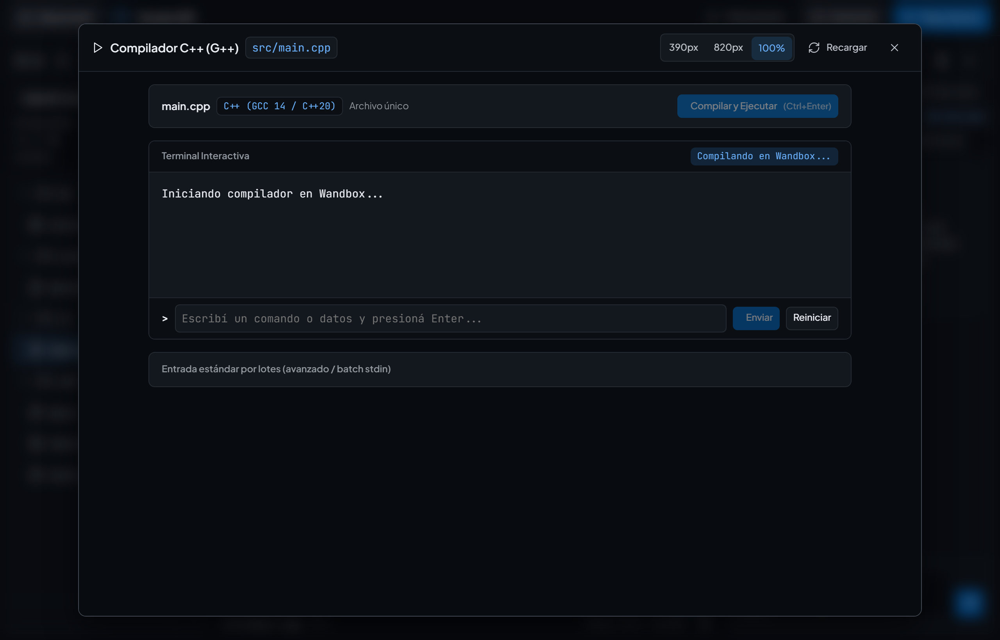
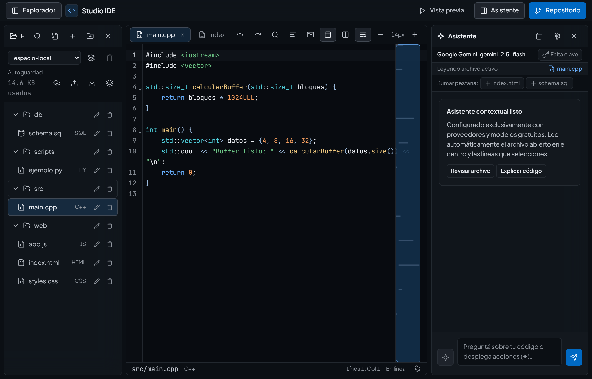
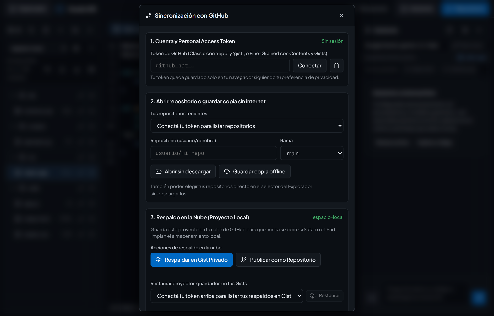

# Manual de Usuario — Studio IDE

> **Versión:** `1.2.0`

Esta guía reúne todo lo que necesitás para instalar **Studio IDE** en tu iPad o PC, dominar todos los atajos de teclado y gestos táctiles, gestionar ramas en GitHub, previsualizar sitios web multi-página de forma responsiva y programar asistido por inteligencia artificial gratuita.

---

## Índice

1. [Instalación en iPad (PWA a pantalla completa) y PC](#1-instalación-en-ipad-pwa-a-pantalla-completa-y-pc)
2. [Recorrido por la interfaz, atajos y gestos táctiles](#2-recorrido-por-la-interfaz-atajos-y-gestos-táctiles)
3. [Gestión de proyectos, exportación `.zip` y almacenamiento](#3-gestión-de-proyectos-exportación-zip-y-almacenamiento)
4. [Vista previa web, Multi-Página, SQLite, C/C++ y Python 3](#4-vista-previa-web-multi-página-sqlite-cc-y-python-3)
5. [Configurar el Asistente de IA gratuito y pasar claves](#5-configurar-el-asistente-de-ia-gratuito-y-pasar-claves)
6. [Trabajar con el Asistente IA sobre tu código](#6-trabajar-con-el-asistente-ia-sobre-tu-código)
7. [GitHub avanzado: Ramas, Diff visual y Commit + Push](#7-github-avanzado-ramas-diff-visual-y-commit--push)

---

## 1. Instalación en iPad (PWA a pantalla completa) y PC

### Paso A: Activar GitHub Pages (una sola vez)
1. Entrá a tu repositorio en GitHub: `https://github.com/mbouso420-spec/ide-ipad`.
2. Dirigite a **Settings** -> menú lateral izquierdo **Pages**.
3. En **Build and deployment** -> **Source**, seleccioná **Deploy from a branch**.
4. En **Branch**, elegí **`main`** y carpeta **`/ (root)`**, luego tocá **Save**.
5. Tras 1 o 2 minutos, tu app estará disponible en:
   `https://mbouso420-spec.github.io/ide-ipad/`

### Paso B: Instalar como app en tu iPad (PWA)
1. Abrí **Safari** en el iPad y navegá a tu URL de GitHub Pages.
2. Tocá el botón **Compartir** (el cuadrado con la flecha hacia arriba).
3. Seleccioná **Agregar a inicio** (*Add to Home Screen*) y tocá **Agregar**.
4. Abrí el nuevo icono azul de **Studio IDE**: se iniciará **a pantalla completa sin marcos de navegador** y con adaptación fluida a ventanas de **Stage Manager**.

---

## 2. Recorrido por la interfaz, atajos y gestos táctiles

<p align="center">
  
</p>

La aplicación organiza el espacio de trabajo en **3 islas ergonómicas**:
* **Izquierda (`Explorador`):** selector de proyectos, árbol de archivos, monitor de cuota y herramientas de importación/exportación.
* **Centro (`Editor`):** barra de pestañas, controles de edición (`Deshacer`, `Rehacer`, `Buscar`, `Ajuste de línea`, tamaño tipográfico), editor de código y la **barra táctil de símbolos rápidos**.
* **Derecha (`Asistente`):** chat contextual con IA, contador de tokens en vivo y configuración de proveedores gratuitos.

### Atajos de teclado (PC o Magic Keyboard en iPad)

| Atajo | Acción |
| :--- | :--- |
| `Alt + W` / `Cmd + W` / `Ctrl + W` | Cierra la pestaña activa (con confirmación si tiene cambios pendientes) |
| `Clic central` (trackpad o mouse) | Cierra la pestaña sobre la que se hace clic (`auxclick`) |
| `Cmd + P` / `Ctrl + P` | Abre la paleta de apertura rápida de archivos |
| `Cmd + P` seguido de `:número` | Salto directo al número de línea (ej. `app.js:140` o `:45` en el archivo activo) |
| `Ctrl + S` / `Cmd + S` | Fuerza el guardado inmediato en `IndexedDB` |
| `Ctrl + B` / `Cmd + B` | Muestra u oculta el panel lateral del Explorador |
| `Ctrl + J` / `Cmd + J` | Muestra u oculta el panel lateral del Asistente IA |
| `Ctrl + F` / `Cmd + F` | Abre el buscador y reemplazador dentro del editor |
| `Ctrl + Z` / `Cmd + Z` | Deshacer en el archivo actual |
| `Ctrl + Espacio` | Abre manualmente el menú de autocompletado inteligente |
| `Enter` (en el chat IA) | Envía el prompt (`Shift + Enter` inserta salto de línea) |
| `Enter` (en modales Git) | Confirma y envía el formulario activo (conectar token, clonar, rama) |
| `Ctrl + Enter` / `Cmd + Enter` | En modal Git: realiza el commit y push inmediato. En SQL/C++: compila/ejecuta |
| `Escape` | Cierra cualquier diálogo modal, menú contextual o paleta |

<p align="center">
  
</p>

### Gestos y ergonomía táctil en el iPad

1. **Menú contextual por pulsación prolongada (*Long-Press*):**
   - Mantené presionado cualquier archivo o carpeta durante ~500 ms (o hacé clic derecho en PC) para abrir el menú flotante con las opciones:
     - **Renombrar:** edición inline sin cuadros de diálogo intrusivos.
     - **Duplicar:** crea una copia exacta respetando extensiones (ej. `modelo.js` -> `modelo.copia.js`).
     - **Descargar:** baja el archivo seleccionado directamente a tu dispositivo.
     - **Eliminar:** pide confirmación visual para evitar borrados accidentales.
2. **Auto-Wrap de selecciones con la barra de símbolos:**
   - Seleccioná con el dedo o cursor una palabra o bloque de texto en el editor y tocá cualquiera de los delimitadores en la barra inferior: `( )`, `{ }`, `[ ]`, `" "`, `' '` o ```` ``` ````.
   - En lugar de sobrescribir el texto, el editor **lo envolverá automáticamente conservando la selección interna**.
3. **Regla de errores en el scrollbar (Error Overview Ruler):**
   - Al lado derecho del editor (sobre la barra de desplazamiento) contás con una regla visual interactiva.
   - Si GCC o el analizador detectan un error o advertencia, se ubica una píldora roja o amarilla a la altura porcentual exacta del código.
   - Tocando o haciendo clic sobre la píldora, el editor salta de inmediato a esa línea sin tener que scrollear a ciegas en archivos largos.
4. **Protección al cerrar pestañas:**
   - Si intentás cerrar una pestaña que tiene cambios locales aún no sincronizados con GitHub, el IDE abre un diálogo de confirmación accesible antes de purgar el estado de memoria del archivo.
5. **Adaptación fluida a la rotación de pantalla:**
   - Si rotás el iPad de horizontal a vertical o reacomodás el tamaño de ventana en Stage Manager, los paneles laterales se re-ajustan proporcionalmente al instante para que nunca desborden la pantalla ni queden cortados.
6. **Guardia de seguridad para imágenes y archivos binarios:**
   - Si abrís una imagen (`.png`, `.jpg`, `.jpeg`, `.gif`, `.webp`, `.svg`, `.ico`), el panel central monta una previsualización visual con sus dimensiones en píxeles, peso formateado y botón de descarga directa.
   - Si abrís cualquier otro archivo binario (`.pdf`, `.zip`, `.wasm`), el IDE presenta una ficha técnica con su peso y opción de descarga, protegiendo a CodeMirror y a la memoria del navegador de corrupciones por texto plano.

---

## 3. Gestión de proyectos, exportación `.zip` y almacenamiento

### Exportación completa a `.zip` (100% Offline)
- En la barra superior del Explorador, tocá el botón **Descargar proyecto (.zip)** (icono de capas).
- El sistema compilará todos los archivos en un archivo `<nombre-del-proyecto>.zip` válido (formato PKZIP 2.0 nativo con CRC-32) y lo descargará en tu iPad o PC al instante, sin necesidad de conexión a internet ni servidores externos.

### Importación segura de archivos
- Tocá el botón de la **flecha hacia arriba** para importar archivos sueltos desde la app *Archivos* de iPadOS o tu explorador de PC.
- Por estabilidad y rendimiento en el iPad, las importaciones cuentan con un límite de seguridad de **5 MB por archivo** y detección automática de codificación UTF-8.

### Monitor de almacenamiento local
- En la parte inferior del Explorador verás el estado en vivo de tu almacenamiento (`~1.2 MB / 1.5 GB`).
- Esta cifra se actualiza automáticamente consultando `navigator.storage.estimate()` para que sepas en todo momento cuánto espacio tenés disponible en tu dispositivo.

---

## 4. Vista previa web, Multi-Página, SQLite, C/C++ y Python 3

Al presionar el botón **Vista previa** en la barra superior:

### Resolución Inteligente del Punto de Entrada (desde `.js` o `.css`)
- Si estás editando un archivo `.js` o una hoja de estilos `.css`, no necesitás cambiar manualmente a la pestaña HTML para probarlo.
- Al tocar **Vista previa**, el motor busca automáticamente qué archivo `.html` en tu proyecto lo importa explícitamente (`<script src="...">` o `<link href="...">`) o toma el `index.html` del proyecto para compilar y mostrar la aplicación completa en contexto.
- En la barra superior del visor verás qué documento HTML se está renderizando (por ejemplo `index.html`) y contás con un botón para alternar a ejecución aislada si querés probar el script JS en solitario.

### Navegación Multi-Página e Historial Web

<p align="center">
  
</p>

- Si tu proyecto tiene múltiples páginas (`index.html`, `catalogo.html`, `contacto.html`), podés hacer clic libremente en cualquier enlace relativo (`<a href="catalogo.html">`, `<a href="./nosotros.html">` o `<a href="../blog/post.html">`) o enviar formularios (`<form action="...">`).
- El visor intercepta la navegación sin recargas molestas y resuelve de forma inteligente el archivo destino en tu workspace.
- **Botones de historial (Atrás / Adelante):** navegá entre las páginas visitadas exactamente igual que en un navegador real.
- **Selector desplegable de páginas HTML:** en la cabecera del visor podés cambiar directamente entre cualquier archivo `.html` existente en el proyecto en un toque. El selector limpia automáticamente carpetas de compilación (`dist`, `build`, `node_modules`, etc.) para no duplicar opciones ni mostrar archivos innecesarios.
- **Soporte transparente para repositorios remotos de GitHub:** si estás trabajando en un repositorio grande con carga bajo demanda (*lazy*), el IDE descarga automáticamente el código de la página que elijas y todas sus hojas de estilo CSS (incluyendo reglas modulares `@import`) y scripts JS vinculados antes de mostrarla, garantizando que el diseño y la interactividad se vean de inmediato sin pantallas en blanco.

### Emulador de medidas responsivas
En la barra superior del modal de vista previa podés alternar el tamaño de pantalla:
- **390px (Móvil):** simula la visualización en teléfonos modernos.
- **820px (Tablet / iPad):** ajusta el contenedor al ancho clásico de tablets.
- **100% (Escritorio):** aprovecha todo el ancho disponible del diálogo.

### Base de Datos SQLite Interactiva en Vivo (`.sql`)
- Al abrir una pestaña con un archivo `.sql` y tocar **Vista previa**, se inicia una base de datos SQLite completa en memoria vía WebAssembly (`sql.js`).
- Ejecuta tus sentencias DDL y DML (`CREATE TABLE`, `INSERT`, `UPDATE`, `DELETE`) mostrando el conteo de filas afectadas y los tiempos de ejecución.
- Si tu script contiene consultas `SELECT`, las presenta en **tablas HTML formateadas y responsivas** con scroll horizontal cómodo al tacto.
- **Paginación cliente fluida (50 filas por página):** para bases de datos con cientos o miles de registros, la tabla se divide en páginas de 50 filas con botones de navegación accesibles (**Anterior** / **Siguiente**) e indicador de registros totales, evitando congelamientos del navegador en tablets.
- **Consola interactiva de consultas:** podés escribir sentencias SQL adicionales en la caja inferior y ejecutarlas con el botón **Ejecutar Consulta** o el atajo `Ctrl + Enter`.
- **Exportación completa y por página de datos:** descargá el resultado de tus consultas en un toque como archivo `.csv` (compatible con Excel / Numbers) o `.json`. La exportación principal procesa **el 100% de los registros completos** independientemente de la página en la que estés posicionado, y disponés además del botón **CSV (Esta página)** en la barra de paginación para descargar únicamente el bloque actual de 50 filas.

### Compilador y Ejecutor Nativo de C y C++ (`.c`, `.cpp`, `.h`)

<p align="center">
  
</p>

- **Aislamiento nativo sin iframes:** al abrir un archivo `.c`, `.cpp` o `.h` y tocar **Vista previa**, la interfaz monta un runner nativo de ejecución dentro del diálogo, evitando bloqueos o interferencias con iframes HTML.
- **Soporte para C (GCC 14 / C17) y C++ (GCC 14 / C++20)** con compilación en la nube mediante la API de Wandbox.
- **Detección y señalización de errores GCC (Línea roja y Tooltip):**
  - Si el compilador detecta un fallo de sintaxis o error de compilación (ej. falta de punto y coma, tipado o headers no encontrados), el sistema parsea el número de línea.
  - El editor CodeMirror 6 pinta el fondo de la línea en **rojo** y muestra un **tooltip explicativo flotante** con el detalle exacto del error.
  - Además, podés hacer clic sobre el error en la terminal del modal para saltar inmediatamente a esa línea en el editor.
- **Soporte multi-archivo automático:** si tu proyecto incluye archivos de cabecera (`.h`, `.hpp`) o archivos fuente complementarios (`.c`, `.cpp`) en la misma carpeta o proyecto, se empaquetan y compilan juntos automáticamente sin configuraciones engorrosas.
- **Consola Interactiva Paso a Paso (Línea de comando `>`):** al abrir un programa que solicita datos (`scanf`, `cin`), la terminal te presenta una línea de entrada interactiva en la parte inferior. Podés tipear tu respuesta (por ejemplo la opción `1`) y presionar `Enter` (o tocar **Enviar**). La terminal avanza mostrando tu respuesta y el siguiente mensaje del programa (ej. *'Ingrese dos números:'*). Luego ingresás los números y volvés a presionar `Enter`, interactuando paso a paso de forma natural sin tener que amontonar todas las entradas de antemano.
- **Botón Reiniciar:** para reiniciar la sesión interactiva desde el principio en cualquier momento con un solo toque.
- **Entrada estándar por lotes (Batch opcional):** sección colapsable avanzada para cuando quieras alimentar el programa con un conjunto masivo de datos predefinidos de una sola pasada.
- **Compilación en un toque (`Ctrl + Enter`):** botón **Compilar y Ejecutar** con atajo de teclado rápido.
- **Terminal de ejecución:** muestra el estado de compilación, advertencias (`-Wall`), errores en rojo, salida estándar (`stdout`), salida de error (`stderr`) y código de salida con tiempo de ejecución en milisegundos.
- **Optimización en repositorios gigantes:** filtrado automático de directorios pesados y descarte de archivos masivos (>512 KB) para garantizar una experiencia fluida sin cuelgues.

### Protección contra bucles infinitos (Loop Guard)
- **JavaScript / HTML:** si un script contiene un `while(true)` o bucle bloqueante, el sistema de protección analiza el código y corta la ejecución a los 2,5 segundos avisando en la consola el número exacto de línea donde se originó el bucle, evitando que Safari se cuelgue.
- **Python 3 (Pyodide WebAssembly):** la ejecución de Python corre en un **Web Worker aislado en segundo plano**. Si un script entra en un bucle prolongado, a los 5 segundos aparece un aviso preventivo y contás con un botón **Detener** que cancela el hilo al instante.
- La consola de Python admite entrada interactiva sin bloqueos mediante la función `input()`.

---

## 5. Configurar el Asistente de IA gratuito y pasar claves

En el panel **Asistente**, tocá el icono del **engranaje** para configurar tu proveedor favorito:

1. **Groq (Gratis — Ultrarrápido):** recomendadísimo para programar en el iPad (`https://console.groq.com/keys`). Modelo sugerido: `openai/gpt-oss-120b`.
2. **Google Gemini (Gratis — AI Studio):** clave en `https://aistudio.google.com/apikey`. Cuenta con selección de modelos gratuitos (`gemini-2.5-flash`, etc.).
3. **OpenRouter (Modelos gratuitos `:free`):** clave en `https://openrouter.ai/keys`.
4. **Mistral (Gratis — La Plateforme):** clave en `https://console.mistral.ai/api-keys`.

### Migración de claves en un toque (PC a iPad)
1. En tu PC, abrí el engranaje del chat y tocá **Copiar pack de claves**.
2. Enviate ese texto a tu iPad (por AirDrop, Notas de iCloud o mensaje).
3. En el iPad, abrí el engranaje, tocá **Importar pack**, pegá el contenido y tocá **Guardar**. Se configurarán tus APIs de IA y tu token de GitHub automáticamente.

---

## 6. Trabajar con el Asistente IA sobre tu código

<p align="center">
  
</p>

* **Lectura contextual inteligente:** el asistente lee el archivo activo y las líneas seleccionadas en el editor.
* **Presupuesto de contexto:** si el archivo es muy extenso, el IDE conserva inteligentemente las funciones iniciales y finales avisando cuántas líneas intermedias fueron omitidas, respetando los límites de tokens de los planes gratuitos.
* **Contador de tokens en vivo:** debajo del campo de texto podés ver cuántos tokens aproximados insume tu mensaje antes de enviarlo.
* **Regenerar respuesta:** si la respuesta no te conforma o querés otra alternativa, tocá el botón **Regenerar respuesta** para reintentar la consulta en un solo toque.
* **Enlaces seguros:** todos los enlaces a documentación que recomiende la IA se abren en pestañas nuevas seguras (`target="_blank" rel="noopener noreferrer"`).
* **Inyección de código con un toque:**
  - **En cursor:** inserta el código exactamente en la posición del cursor.
  - **Reemplazar código:** sustituye el fragmento seleccionado si hay uno activo. Si no hay selección previa, **reemplaza el documento completo de forma segura**, evitando escribir encima de código existente o pegarlo en la posición del cursor.
  - **Aplicar archivo:** abre el **Visor de Diferencias (Diff)** para que veas en verde y rojo los cambios antes de aceptarlos.

---

## 7. GitHub avanzado: Ramas, Diff visual y Commit + Push

<p align="center">
  
</p>

### Conectar tu cuenta con Personal Access Token (PAT)
Podés usar cualquiera de los dos tipos de token de GitHub:
1. **Opción A (Recomendada — Token Classic sin restricciones):**
   - En GitHub: **Settings** -> **Developer settings** -> **Personal access tokens** -> **Tokens (classic)** -> **Generate new token (classic)**.
   - Marcá las casillas **`repo`** (para repositorios) y **`gist`** (para respaldos en la nube).
2. **Opción B (Fine-grained token):**
   - En **Personal access tokens** -> **Fine-grained tokens**.
   - En **Repository permissions**: **Contents: Read and write**.
   - En **Account permissions**: **Gists: Read and write**.
3. En el IDE, tocá **Repositorio**, pegá el token y tocá **Conectar**.

### Carga bajo demanda y modo offline
- Tus repositorios aparecerán en el selector del Explorador. Al seleccionar uno, el árbol de carpetas se genera en milisegundos y los archivos se descargan individualmente recién al abrirlos.
- Si vas a viajar o quedarte sin conexión, tocá el botón **Guardar copia offline** (icono de nube en el explorador) para descargar todo el proyecto al iPad (`[Offline]`).

### Gestión de Ramas (Branches)
- En el modal **Repositorio** (sección de sincronización):
  - **Selector de rama:** podés alternar en qué rama de trabajo querés sincronizar tus cambios.
  - **Nueva rama:** tocá **Nueva rama**, escribí el nombre (ej. `feature/formulario-contacto`) y tocá **Crear**. La rama se bifurcará en GitHub a partir del commit actual y quedará lista como tu rama activa.

### Inspección de cambios y Commit + Push atómico
1. Cada modificación, archivo nuevo o eliminado se calcula en tiempo real frente al árbol remoto.
2. Tocá el botón **Commit (X)** arriba a la derecha.
3. Podés tocar **Diff** al lado de cualquier archivo para revisar línea por línea las modificaciones en verde y rojo.
4. Escribí un mensaje descriptivo y presioná **Commit y Push a GitHub**.
5. Se generará un commit atómico en el servidor de GitHub preservando permisos de ejecución de scripts y garantizando la integridad de tu código.

### Respaldo en la Nube para Proyectos Locales (Gists Privados y Publicación)
Si estás trabajando en un proyecto local (guardado en el almacenamiento del iPad) y no querés correr ningún riesgo de perderlo ante limpiezas de caché de Safari:
* **Respaldo en un toque desde el Explorador:** Tocá el botón con la flecha hacia arriba y la nube (`Respaldar en Gist Privado`) en la barra inferior del explorador. El sistema creará o actualizará automáticamente un **Gist Secreto** en tu cuenta de GitHub con todos los archivos de tu proyecto.
* **Publicar como nuevo Repositorio Privado:** Al abrir la ventana **Repositorio** estando parado en un proyecto local, contás con el botón **Publicar como Repositorio**. Le asignás un nombre y el IDE creará el repositorio privado en tu cuenta de GitHub, subirá todos los archivos en un commit inicial y lo dejará listo para sincronizar con Git.
* **Restaurar proyectos en cualquier dispositivo:** Si abrís el IDE desde tu PC o desde otro iPad, en la ventana **Repositorio** podés desplegar la lista de tus **Gists respaldados** y tocar **Restaurar** para tener tu proyecto abierto y listo para seguir programando al instante.
