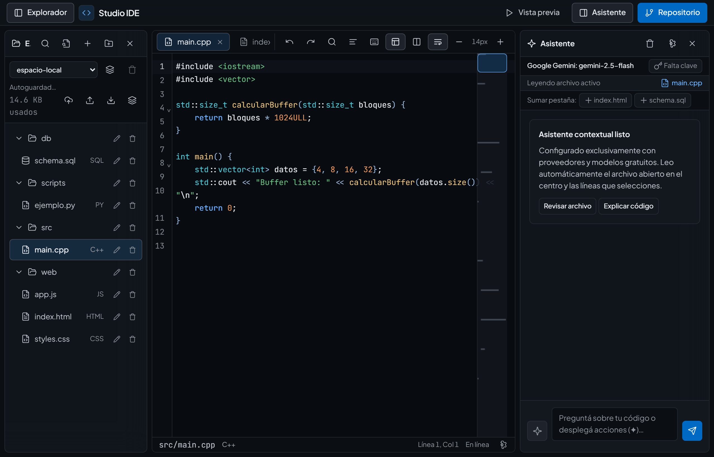
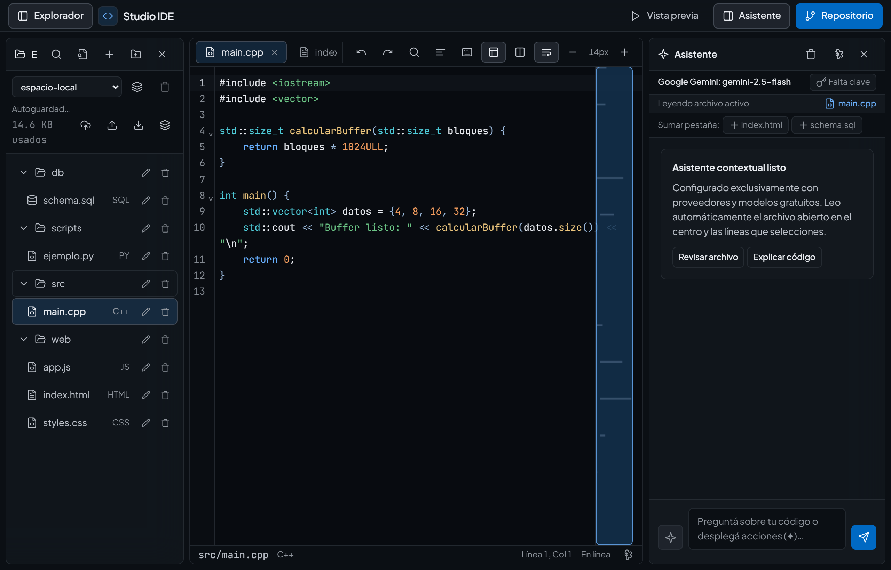
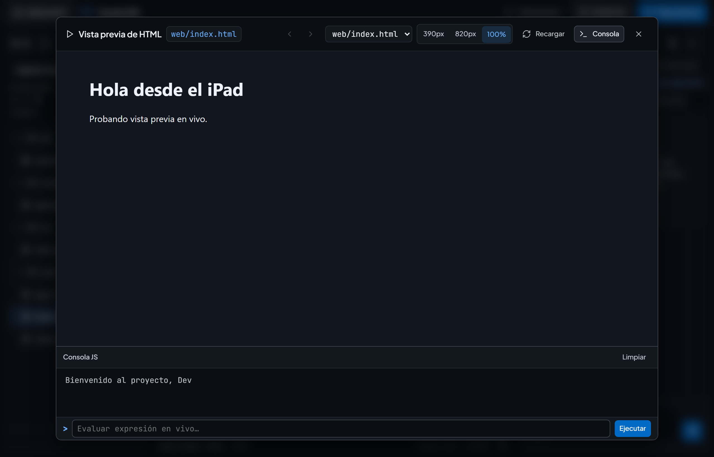
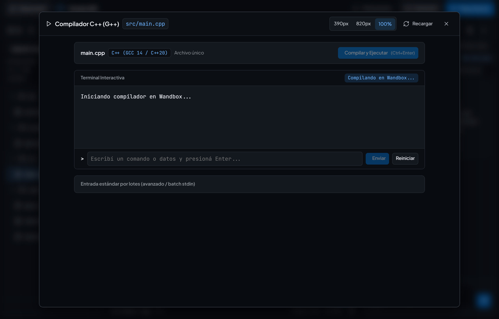

# Studio IDE — Editor de Código Web para iPadOS y Escritorio

<p align="center">
  
</p>

**Studio IDE** es un entorno de desarrollo web ligero, modular y 100% offline-first sin servidores intermedios, diseñado específicamente para programar con fluidez desde un **iPad** (instalado como PWA a pantalla completa en Safari y adaptable a ventanas de **Stage Manager**) así como desde una **PC de escritorio**.

- **Versión actual:** `1.2.0`
- **Aplicación web (GitHub Pages):** https://mbouso420-spec.github.io/ide-ipad/
- **Manual de Usuario paso a paso:** [Ver Manual de Usuario completo (`MANUAL_DE_USUARIO.md`)](./MANUAL_DE_USUARIO.md)
- **Suite de pruebas automáticas:** 588 pruebas automatizadas en 139 suites + suites E2E en Chromium (`npm --prefix tests run test:e2e`) y WebKit/Safari (`npm --prefix tests run test:e2e:webkit`) (tests unitarios, bundler de módulos ES offline, lazy loading de runtimes, integridad PWA SW v30, concurrencia multi-pestaña, *Soak & Endurance*, *AppSec Auth Hardening* y pruebas E2E en navegadores reales, 0 fallos en la suite rápida).

---

## Características principales

### 1. Interfaz de 3 islas optimizada para iPadOS y Escritorio
- **Isla izquierda (Explorador):**
  - Gestión de múltiples proyectos locales o vinculados a repositorios de GitHub.
  - Árbol jerárquico de carpetas y archivos con creación, renombrado y borrado inline accesible (sin popups que bloqueen Safari ni pérdida de posición de scroll).
  - **Menú contextual táctil (`Long-Press` ~500ms y clic derecho):** menú flotante para renombrar, duplicar inteligentemente (ej. `archivo.copia.js`, `archivo.copia 2.js`), descargar y eliminar.
  - **Trampa de foco accesible:** navegación fluida con `Tab` / `Shift+Tab` dentro de los formularios inline.
  - **Exportación e importación segura:** descarga del proyecto completo en formato `.zip` estándar (PKZIP 2.0 nativo 100% offline) y límite de seguridad de 5 MB en importaciones con detección de codificación.
  - **Monitor de almacenamiento persistente:** indicador en vivo de cuota y uso (`navigator.storage.estimate`) y respaldo en Gist privado en la barra superior del explorador.
- **Isla central (Editor CodeMirror 6 con fallback resiliente):**
  - Soporte de pestañas múltiples con liberación inmediata de memoria (`dropFileState`) al cerrarlas.
  - **Atajos de cierre rápido:** `Alt + W`, `Cmd + W`, `Ctrl + W` o clic central del mouse/trackpad (`auxclick`).
  - **Protección contra pérdida de datos:** diálogo modal de confirmación accesible (`#confirm-dialog`) si se intenta cerrar una pestaña con cambios pendientes frente al repositorio.
  - **Barra táctil de símbolos con Auto-Wrap:** al seleccionar texto y tocar delimitadores (`( )`, `{ }`, `[ ]`, `" "`, `' '`, ```` ``` ````), el contenido seleccionado se envuelve automáticamente conservando la selección interna.
  - **Paleta de apertura rápida (`Cmd + P` / `Ctrl + P`):** filtrado instantáneo de archivos y salto directo a línea mediante la sintaxis `:número` (ej. `app.js:140` o `:45` sobre el archivo activo).
  - **Regla visual de errores en el scrollbar (Error Overview Ruler):** barra lateral derecha (`#editor-error-ruler`) que posiciona proporcionalmente píldoras interactivas de diagnóstico (errores de GCC o sintaxis), permitiendo saltar a la línea afectada con un solo toque.
  - **Guardia de seguridad para archivos binarios:** imágenes (.png, .jpg, .webp, .svg, etc.) y recursos binarios (.pdf, .zip, .wasm) se visualizan en un visor seguro dedicado con previsualización visual o ficha técnica y opción de descarga directa, protegiendo a CodeMirror y a la memoria del navegador de corrupciones por texto plano.
  - Resaltado de sintaxis para **Python, C, C++, HTML, CSS, JavaScript y SQL**, autocompletado inteligente, búsqueda/reemplazo y control de tamaño tipográfico.
- **Adaptación a Stage Manager y teclado virtual:**
  - Control dinámico de `visualViewport` para evitar desplazamientos accidentales al desplegar el teclado táctil de iPadOS.
  - Re-clamp dinámico e instantáneo de dimensiones de paneles ante cambios de orientación de pantalla (`orientationchange`, `screen.orientation`) o redimensionamiento de ventanas en Stage Manager.

### 2. Asistente de IA integrado (APIs gratuitas y seguras)

<p align="center">
  
</p>

- Conexión directa desde el navegador con niveles gratuitos de **Groq** (`openai/gpt-oss-120b`), **Google Gemini** (`AI Studio`), **OpenRouter** (`openrouter/free`) y **Mistral** (`La Plateforme`), con sincronización automática de modelos.
- **Presupuesto y truncamiento inteligente de contexto:** preserva cabecera y pie del código advirtiendo líneas omitidas para evitar agotar la ventana de contexto de modelos gratuitos.
- **Contador de tokens en tiempo real:** estimador visual (~4 caracteres por token) en el compositor del chat.
- **Regeneración rápida de respuestas:** botón dedicado para reintentar la última consulta con un solo toque.
- **Saneamiento automático del historial:** limpia notas de interrupción si se cancela una generación en curso.
- **Enlaces Markdown seguros:** renderizado sanitizado con `target="_blank"` y `rel="noopener noreferrer"`, bloqueando esquemas no seguros (`javascript:`, `data:`).
- **Acciones directas en bloques de código:** *En cursor*, *Reemplazar código* (reemplaza limpiamente el archivo completo si no hay selección o el fragmento seleccionado si lo hay, evitando sobrescrituras accidentales en el cursor), *Copiar* y *Aplicar archivo* con apertura previa del **Visor de Diferencias (Diff)** visual en verde y rojo.

### 3. Vista previa contextual en vivo, Consola, Multi-Página, SQLite y C/C++

<p align="center">
  
</p>

- **Resolución inteligente de punto de entrada:** al presionar *Vista previa* estando parado en un `.js` o `.css`, el motor busca en el workspace el `.html` que lo referencia directamente o el `index.html` principal, ensayando la aplicación web completa en lugar de correr scripts aislados.
- **Navegación multi-página e Historial web:** Total Interceptor en el iframe que captura enlaces locales relativos (`<a href="contacto.html">`), envíos de `<form>` y llamadas de navegación programática (`location.assign`), ofreciendo botones de **Atrás / Adelante** y un selector desplegable de páginas HTML en la barra superior.
- **Precarga y descarga bajo demanda inteligente (GitHub Lazy):** en repositorios remotos donde los archivos no están descargados previamente (`contentLoaded: false`), el motor de vista previa descarga automáticamente el HTML destino y todos los assets CSS y JS vinculados antes de compilar el iframe, evitando pantallas en blanco y estilos rotos.
- **Inlining recursivo de `@import url(...)` en CSS y Bundler ES Modules 100% Offline (`moduleBundler.js`):** empaqueta hojas de estilo modulares con `@import`, transpila archivos `.ts`/`.tsx`/`.jsx` y compila grafos locales de `import`/`export` (incluyendo barril `index.ts`, ciclos, `.json`, `.css` e `import type`) dentro de un registro virtual compatible con la CSP estricta (sin depender de `blob:` URLs ni red en `<iframe srcdoc sandbox>`).
- **Selector de páginas HTML optimizado y sin duplicados:** exclusión de carpetas de dependencias y artefactos de empaquetado (`node_modules`, `.git`, `dist`, `build`, `.next`, `.cache`, `out`, etc.), deduplicación por ruta normalizada y desambiguación automática de nombres con rutas relativas para evitar opciones triplicadas.
- **Bases de datos SQLite en vivo (.sql):** ejecución directa de sentencias DDL/DML mediante WebAssembly en memoria (`sql.js`), tablas interactivas con paginación fluida de 50 filas por página (`PAGE_SIZE = 50`) y controles accesibles, contador de filas afectadas, editor de consultas rápidas y exportación directa del 100% de los datos a `.csv` o `.json`.

<p align="center">
  
</p>

- **Aislamiento y Runner nativo de C y C++ (.c, .cpp, .h):** ejecución en un shell nativo del modal con **Terminal Interactiva Paso a Paso** (con línea de comando `>`, envío interactivo de respuestas paso a paso con `Enter` sin amontonar entradas previas, e historial con flechas Arriba/Abajo para repetir valores), panel de estado, entrada opcional por lotes (`batch stdin`), y compilación multi-archivo en Wandbox (GCC 14 C17/C++20).
- **Detección y señalización de errores GCC (Línea roja y Tooltip):** parseo automático de las líneas de error del compilador (`file:line:col: error: ...`), marcación visual con fondo rojo en CodeMirror 6 (`addErrorMarker`) y tooltip flotante con el mensaje del compilador, más salto interactivo al hacer clic sobre el error en la terminal.
- **Optimización para repositorios gigantes:** empaquetado perezoso con filtrado de directorios pesados (`node_modules`, `.git`, `dist`, `build`, etc.) y umbral máximo de tamaño por archivo (512 KB) para prevenir congelamientos en proyectos masivos.
- **Selector de medidas responsivas (Device Switcher):** botones de alternancia en la cabecera del visor para probar el diseño en **Móvil (390px)**, **Tablet / iPad (820px)** y **Escritorio (100%)** con transiciones suaves.
- **Protección contra bucles infinitos (Loop Guard):**
  - **JavaScript / HTML:** instrumentación de bucles vía AST (Acorn) que interrumpe bucles infinitos a los 2,5 s indicando el número de línea exacto para proteger la memoria del iPad.
  - **Python 3:** ejecución aislada en un **Web Worker** en segundo plano (Pyodide WebAssembly) con botón de **Detener** inmediato que aborta bucles infinitos sin congelar la interfaz.
- **Consola integrada:** captura de `console.log`, `warn`, `error` y trazas de Python con entrada inline interactiva (`input()`).

### 4. Persistencia offline y Sincronización avanzada con GitHub

<p align="center">
  
</p>

- Autoguardado continuo en **`IndexedDB`** con respaldo síncrono de emergencia (`localStorage`) ante suspensiones repentinas de Safari.
- **Integración con GitHub REST API v3 / Octokit:**
  - **Apertura instantánea sin clonar todo:** visualización del árbol de directorios con descarga perezosa (*lazy*) de archivos bajo demanda.
  - **Gestión de Ramas (Branches):** selector de rama activa y creación/bifurcación de nuevas ramas directamente desde el IDE.
  - **Detección de divergencias remotas:** protección contra sobrescritura si el repositorio remoto avanzó (`RemoteAheadError`).
  - **Commits atómicos:** creación de árbol Git completo (altas, modificaciones y bajas en una sola transacción) preservando modos ejecutables (`100755`).
  - **Modo Offline:** descarga completa del repositorio (`[Offline]`) para trabajar en aviones o zonas sin conectividad.

---

## Seguridad y Arquitectura Offline

1. **Content Security Policy (CSP) Estricta:**
   `index.html` declara una directiva CSP restrictiva que autoriza únicamente las APIs oficiales de GitHub y proveedores de IA (`api.github.com`, `generativelanguage.googleapis.com`, `api.groq.com`, `openrouter.ai`, `api.mistral.ai`), el compilador seguro de C/C++ (`https://wandbox.org`), CDNs certificados para ESM y librerías WebAssembly (`esm.sh`, `cdn.jsdelivr.net`, `cdnjs.cloudflare.com`) y orígenes de fuentes seguros (`fonts.googleapis.com`, `fonts.gstatic.com`).
2. **Service Worker (`studio-ide-shell-v30` y `studio-ide-runtime-v2`):**
   - Estrategia **Network-First** para el App Shell propio con reintento/fallback en precacheo, soporte `{ ignoreSearch: true }`, y protección contra respuestas HTTP 5xx sobre caché válido.
   - Pre-cacheo completo de los módulos vigentes (incluyendo `js/preview/moduleBundler.js`, `js/security/credentialGuard.js`, `js/security/keyVaultCrypto.js`, `js/github/githubMerge.js`, `js/editor/codeFormatter.js`, `js/preview/tsTranspiler.js`, `js/preview/htmlBundler.js`, el analizador sintáctico Acorn, las 16 dependencias CDN del importmap CodeMirror/Octokit con precalentamiento acotado de sub-chunks de `esm.sh` y Pyodide en best-effort) durante el evento `install`, y revalidación SWR CDN con `event.waitUntil` sin almacenar respuestas `opaque`.
3. **Blindaje de Credenciales y Anti-Fuerza Bruta (`js/security/credentialGuard.js` y `js/security/keyVaultCrypto.js`):**
   - **Lockout progresivo y persistente (*Exponential Backoff & Lockout*):** ante intentos fallidos consecutivos (umbral de 4 fallos en `LOCKOUT_THRESHOLD`), bloquea nuevas peticiones por *scope* aislado (`github` y `ai:<providerId>`) con ventanas progresivas de `30s -> 2m -> 5m` (`LOCKOUT_DURATIONS_MS`) persistidas entre recargas (`localStorage` / `sessionStorage`).
   - **Validación pre-vuelo de formato y entropía:** inspecciona localmente longitud, ausencia de espacios internos, prefijos esperados y entropía antes de ejecutar `fetch()`, bloqueando caracteres de control e inyecciones CRLF (`\r`/`\n`) en cabeceras HTTP.
   - **Lista negra de sesión por huella criptográfica:** registra huellas irreversibles de 96 bits (`fp_<24 hex>` sin fuga de longitud, `computeTokenFingerprint`) para credenciales rechazadas (`401`/`403`) y evita su reenvío repetido en la sesión sin almacenar el secreto rechazado.
   - **Higiene y redacción automática de secretos:** sanea mensajes de error, trazas y logs mediante `redactSensitiveTokens` y enmascara vistas previas en el DOM con `maskCredentialPreview`.
   - **Portabilidad cifrada AES-GCM 256 (`keyVaultCrypto.js`):** exportación e importación de credenciales protegida con contraseña maestra (`PBKDF2-HMAC-SHA256` + `AES-GCM-256` vía Web Crypto API) desde Configuración → Almacenamiento.
4. **Privacidad de credenciales:**
   Las API Keys y tokens personales (PAT) de GitHub nunca se envían a servidores intermedios; residen exclusivamente en `localStorage` o `sessionStorage` según la preferencia del usuario.
5. **Empaquetador ZIP Nativo:**
   Implementación pura en JavaScript sin librerías externas para exportar proyectos a `.zip` cumpliendo estrictamente con la CSP y operando 100% fuera de línea.

---

## Estructura del Proyecto

```text
.
├── index.html                  # Shell principal, CSP, diálogos modales accesibles y maquetación
├── manifest.json               # Manifiesto Web App (PWA standalone para iPadOS y escritorio)
├── sw.js                       # Service Worker v30 (App Shell + Runtime Cache v2 de Acorn/Importmap/CDNs)
├── .github/workflows/ci.yml    # CI en GitHub Actions (lint, Node QA, Chromium E2E y WebKit E2E)
├── .nojekyll                   # Desactiva el procesamiento de Jekyll en GitHub Pages
├── README.md                   # Documentación técnica y arquitectura de la solución
├── MANUAL_DE_USUARIO.md        # Manual exhaustivo para el usuario final (iPad y PC)
├── assets/
│   ├── icon.svg                # Isotipo vectorial (full-bleed en zona segura para maskable)
│   ├── apple-touch-icon.png    # Icono 180x180 para inicio de iPadOS
│   └── icon-512.png            # Icono 512x512 para instalación PWA
├── css/
│   ├── tokens.css              # Tokens de diseño (OKLCH con contraste WCAG 2.1 AA en los 4 temas, tipografía, espaciado)
│   ├── base.css                # Reset accesible, focus visible y reglas base
│   ├── layout.css              # 3 islas, drawers para Stage Manager y gestión de visualViewport
│   ├── editor.css              # Estilos de pestañas, CodeMirror 6 y scrollbars
│   ├── chat.css                # Panel de IA, medidor de tokens y Markdown con enlaces seguros
│   ├── workspace.css           # Árbol de archivos, menú contextual, modal de ramas, Diff, visor y terminal
│   └── app.css                 # Importador central, utilidades globales y cascada táctil iOS/iPadOS
├── js/
│   ├── app.js                  # Orquestador central de estado, atajos globales y diálogos
│   ├── editor/
│   │   ├── editorManager.js    # Motor CodeMirror 6, auto-wrap y ciclo de vida de estados (dropFileState)
│   │   ├── smartReplace.js     # Reemplazo inteligente de fragmentos IA por similitud estructural
│   │   ├── autocompleteCatalog.js # Vocabulario por lenguaje y barra táctil de sugerencias
│   │   ├── splitEditorController.js # Vista dividida paralela con redimensionamiento sincronizado
│   │   ├── minimap.js          # Minimapa lateral de código
│   │   └── codeFormatter.js    # Formateador offline determinista (Shift+Alt+F)
│   ├── storage/
│   │   ├── workspaceDb.js      # Persistencia IndexedDB y modelo de diferencias locales
│   │   ├── emergencyBackup.js  # Respaldo síncrono para suspensiones de Safari
│   │   ├── fileImport.js       # Decodificación segura de archivos con límite de 5 MB
│   │   ├── storageQuota.js     # Monitor de cuota y uso (navigator.storage.estimate)
│   │   └── zipExporter.js      # Exportador ZIP nativo (PKZIP 2.0 y CRC-32)
│   ├── ai/
│   │   ├── providers.js        # Adaptadores de proveedores de IA y bóveda de claves
│   │   └── chatController.js   # Chat contextual, contador de tokens y saneamiento
│   ├── github/
│   │   ├── githubService.js    # Cliente REST GitHub (árboles, ramas, blobs y push atómico)
│   │   ├── githubMerge.js      # Pull 3-way seguro y resolución selectiva de conflictos
│   │   ├── githubLocalBackupPanel.js # Respaldo en Gists privados y publicación de repos nuevos
│   │   └── githubController.js # Interfaz de usuario para repositorios, ramas y sincronización
│   ├── net/
│   │   └── networkErrors.js    # Manejo amigable y categorización de fallas de red
│   ├── preview/
│   │   ├── previewUtils.js     # Utilidades compartidas de rutas, extensiones y escape seguro
│   │   ├── htmlBundler.js      # Empaquetado multi-archivo HTML/CSS/JS/TS y Mini-REPL
│   │   ├── moduleBundler.js    # Compilador y resolver offline de módulos ES para iframe sandbox
│   │   ├── markdownPreview.js  # Renderizado sanitizado de vistas previas Markdown
│   │   ├── pythonRunner.js     # Ejecutor aislado de Python 3 (Pyodide Web Worker) con entrada inline
│   │   ├── tsTranspiler.js     # Transpilador ligero 100% offline para TypeScript y JSX/TSX
│   │   ├── loopGuard.js        # Protección contra bucles infinitos en JS/HTML vía AST
│   │   ├── sqlRunner.js        # Motor de bases de datos SQLite interactivo con sql.js (WebAssembly)
│   │   └── cRunner.js          # Compilador y ejecutor interactivo multi-archivo de C y C++ (Wandbox)
│   ├── security/
│   │   ├── credentialGuard.js  # Bloqueo anti-fuerza bruta, validación pre-vuelo, huellas y redacción
│   │   └── keyVaultCrypto.js   # Cifrado portátil AES-GCM 256 + PBKDF2-SHA256 de credenciales
│   └── ui/
│       ├── layout.js           # Re-clamp de paneles, rotación y Stage Manager
│       ├── binaryPreview.js    # Visor protegido de imágenes y archivos binarios
│       ├── explorerController.js # Árbol del explorador, long-press, duplicación y scroll
│       ├── symbolBar.js        # Barra de símbolos dinámicos según el lenguaje
│       ├── quickOpenModal.js   # Paleta Cmd+P con soporte de salto a línea (:num)
│       ├── globalSearchModal.js # Modal de búsqueda y reemplazo global en proyecto
│       ├── settingsModal.js    # Gestión segura de claves, idioma de interfaz y ajustes
│       ├── keyboardRouter.js   # Enrutador global de atajos de teclado (Cmd/Ctrl)
│       ├── diffModal.js        # Visor de diferencias LCS línea por línea
│       ├── livePreviewModal.js # Previsualización multi-página, selector de páginas, REPL y medidas
│       └── icons.js            # Iconografía SVG optimizada
└── tests/                      # Suite automatizada con 588 pruebas en 139 suites + E2E Chromium y WebKit
```

---

## Verificación de Calidad y Pruebas

Para ejecutar la suite completa de pruebas unitarias y de integración sobre Node.js:

```bash
node --test tests/lint.test.js
npm --prefix tests test
npm --prefix tests run test:e2e
npm --prefix tests run test:e2e:webkit
```

Resultado actual:
- **1/1 verificación de análisis estático (ESLint)** limpia sobre `js/**/*.js`, `sw.js`, `scripts/*.js` y `tests/*.{js,mjs}` (`no-undef` + `no-unused-vars`).
- **588 pruebas automatizadas en Node** distribuidas en **139 suites** (`npm --prefix tests test`: unitarias, regresiones de auditoría y ronda 2, bundler ES Modules multi-archivo offline, lazy loading y aislamiento QA, integridad PWA SW v30, concurrencia multi-pestaña, *Soak & Endurance*, *AppSec Auth Hardening*, bóveda WebCrypto, merge 3-way, formateador y TS/JSX), **0 fallos, 0 pruebas canceladas**.
- **Suite E2E en navegador real Chromium (`tests/browser.e2e.mjs`):** arranque, SW v30, IndexedDB, formateador + Undo, TSX/ES Modules multi-archivo en `iframe srcdoc` bajo CSP, Mini-REPL, AES-GCM WebCrypto y rotación iPadOS verificados en Chromium headless (ejecutada en CI fuera de sandbox).
- **Suite E2E Cross-Engine en WebKit (`tests/webkit.e2e.mjs`):** render táctil iPadOS portrait/landscape sin desbordes, IndexedDB, formateador, ES Modules multi-archivo en CSP y WebCrypto verificados en motor WebKit (Playwright, ejecutada en CI fuera de sandbox).

---

## Ejecución Local en Desarrollo

Para probar localmente la aplicación antes de subir cambios a producción:

```bash
# Servidor HTTP estático nativo de Python 3
python -m http.server 8080

# O bien mediante Node.js
npx serve .
```

Abrí `http://localhost:8080` en tu navegador. Para más información, consultá el [**Manual de Usuario (`MANUAL_DE_USUARIO.md`)**](./MANUAL_DE_USUARIO.md).

## Licencia

Este proyecto está bajo la Licencia MIT. Consultá el archivo [`LICENSE`](./LICENSE) para más detalles.  
Copyright (c) 2026 Mateo Bouso.
